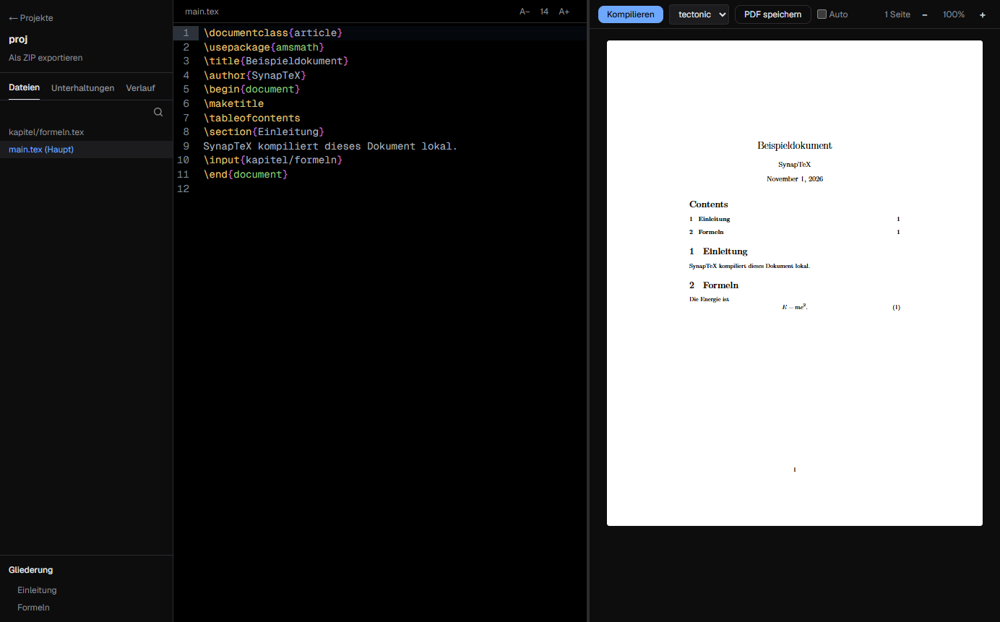

<div align="center">


# SynapTeX <sup><em>0.1</em></sup>

**Deutsch** | [English](docs/readme/README.en.md) | [Türkçe](docs/readme/README.tr.md) | [Español](docs/readme/README.es.md) | [Français](docs/readme/README.fr.md)

**Lokaler LaTeX-Editor für den Desktop, mit eigener KI auf deinem Rechner.**

Schreibe und kompiliere LaTeX ohne Cloud. Deine Dokumente und KI-Unterhaltungen bleiben auf deinem Computer.

[](https://github.com/Teoman951/synaptex/releases/latest)

<sub>Windows zeigt beim ersten Start eine Warnung, weil der Installer noch nicht signiert ist: „Weitere Informationen“, dann „Trotzdem ausführen“.</sub>

[](LICENSE)
[](#status)


</div>



## Warum SynapTeX

- **Lokal:** Kompilieren und KI laufen auf deinem Computer. Ein Konto brauchst du nicht.
- **Overleaf-Projekte weiterführen:** ZIP importieren, kompilieren, weiterschreiben.
- **Verständliche Fehler auf Deutsch:** Ein Klick springt zur Stelle, und häufige Fehler kommen mit Lösungshinweis.
- **KI, die du kontrollierst:** Vorschläge landen erst nach deiner Bestätigung im Dokument.

## Funktionen

### Schreiben

- LaTeX-Editor mit Syntax-Highlighting und Zeilennummern
- Projektordner mit Dateiliste und Gliederung über `\input` und `\include` hinweg
- Automatisches Speichern
- Projektübersicht mit Suche und Vorschaubildern

### Kompilieren

- Tectonic ist mitgeliefert, neue Dokumente kompilieren ohne Einrichtung (Pakete werden beim ersten Mal geladen)
- pdfLaTeX, XeLaTeX und LuaLaTeX über eine lokale TeX-Installation, empfohlen für Overleaf-Projekte
- Literaturverzeichnis mit BibTeX oder Biber und automatische Durchläufe
- PDF-Vorschau mit Zoom, Fortschrittsanzeige und Abbrechen
- Optionales Auto-Kompilieren nach dem Tippen
- Ausführung von Fremdprogrammen aus Dokumenten (`shell-escape`) bleibt ausgeschaltet

### Lokale KI (experimentell)

- Unterhaltungen pro Projekt mit einem `llama.cpp`-Server, der nur auf `127.0.0.1` lauscht
- Code aus Antworten per Klick übernehmen
- Lange Unterhaltungen auf Wunsch komprimieren, mit Hinweisen zum Speicherplatz

Kleine lokale Modelle machen Fehler. Prüfe Vorschläge, bevor du sie übernimmst.

## Status

SynapTeX ist in früher Entwicklung und getestet unter Windows. macOS und Linux sind vorbereitet, aber ungetestet. Der Installer ist noch nicht signiert, Windows zeigt deshalb eine Warnung.

Geplant ist unter anderem Zusammenarbeit.

**Netzwerk:** Die App prüft beim Start auf GitHub, ob ein Update vorliegt, und fragt vor dem Download. Pakete und Modelle werden nur bei Bedarf geladen.

## Erste Schritte

Den Windows-Installer findest du unter [Releases](https://github.com/Teoman951/synaptex/releases).

Zum Entwickeln brauchst du [Node.js](https://nodejs.org) und eine TeX-Distribution wie [MiKTeX](https://miktex.org) oder TeX Live.

```bash
git clone https://github.com/Teoman951/synaptex.git
cd synaptex
npm install
node scripts/fetch-tectonic.mjs
npm run dev:desktop
```

Die KI richtest du im Reiter **Unterhaltungen** ein: Vorhandene Modelle werden erkannt, weitere lassen sich per Klick laden.

### Befehle

| Befehl | Zweck |
| --- | --- |
| `npm run dev:desktop` | Next.js-Dev-Server und Electron starten |
| `npm run start:desktop` | Statischen Export bauen und in Electron starten |
| `npm run build` | Next.js-Build nach `out/` |
| `npm run package:desktop` | Installer nach `release/` bauen |
| `npm run package:dir` | Entpackte App nach `release/` bauen |
| `npm run typecheck` | TypeScript prüfen |
| `npm run lint` | ESLint ausführen |

## Architektur

Gebaut mit Electron, Next.js, React, CodeMirror 6, PDF.js und Tailwind CSS.

- `electron/`: Main-Prozess, Preload, Compiler, ZIP-Import, Gliederung, KI und Unterhaltungen. Der Renderer läuft mit Sandbox und Context Isolation und erreicht Systemfunktionen nur über `window.synaptexDesktop`.
- `src/components/`: Oberfläche mit `layout`, `editor`, `preview` und `chat`.
- `src/state/`: Projektzustand.
- `src/lib/`: Desktop-Zugriff und LaTeX-Fehlerhinweise.

Wichtige Entscheidungen:

- **`app://` statt `file://`:** Im Produktionsmodus liefert ein eigenes Protokoll `out/` aus. So funktionieren die absoluten `/_next`-Pfade, und es lässt sich eine CSP setzen.
- **Pfade bleiben im Main-Prozess:** Der Renderer kennt nur Pfade relativ zum Projekt, das im nativen Dialog gewählt wurde.
- **Main-Prozess als `.mjs`, Preload als `.cjs`:** kein zusätzlicher Build-Schritt. Sandbox-Preloads müssen CommonJS sein.
- **Abhängigkeiten des Main-Prozesses** müssen unter `build.files` in `package.json` stehen.

## Lizenz

SynapTeX steht unter der [GNU Affero General Public License v3.0](LICENSE).
