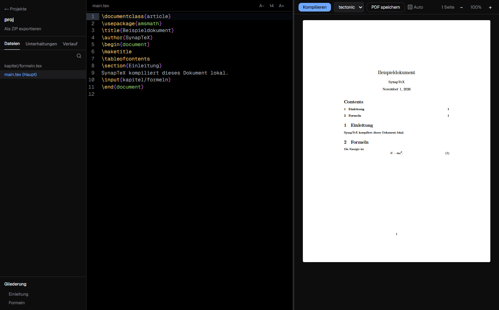

<div align="center">


# SynapTeX

[Deutsch](../../README.md) | **English** | [Türkçe](README.tr.md) | [Español](README.es.md) | [Français](README.fr.md)

**A local LaTeX desktop editor with its own AI on your computer.**

Write and compile LaTeX without a cloud. Your documents and AI conversations stay on your computer.

[](https://github.com/Teoman951/synaptex/releases/latest) [](https://github.com/Teoman951/synaptex/releases/latest)

<sub>Windows shows a warning on first start because the installer is not signed yet: choose "More info", then "Run anyway".</sub>

</div>



## Why SynapTeX

- **Local:** Compiling and AI run on your computer. No account needed.
- **Continue Overleaf projects:** Import the ZIP, compile, keep writing.
- **Helpful errors:** One click jumps to the location, and common errors come with a hint. Hints are in German for now.
- **AI you control:** Suggestions enter the document only after you review the diff.

## Features

- LaTeX editor with syntax highlighting, autosave and checkpoints
- Project folders, outline across `\input` and `\include`, project overview
- Bundled Tectonic, plus pdfLaTeX, XeLaTeX and LuaLaTeX through a local TeX installation
- PDF preview with zoom, text selection, saving and click-to-source
- Optional auto-compile while typing
- Local AI (experimental): detects models from Ollama, LM Studio, GPT4All and Hugging Face, or downloads one with a click

Small local models make mistakes. Check suggestions before applying them.

## Security

LaTeX documents can read files outside the project while compiling, and with Tectonic also write there. SynapTeX warns about suspicious commands but cannot reliably detect targeted attacks. Only compile projects from sources you trust.

## Status

SynapTeX is in early development and tested on Windows. The interface is available in five languages. Linux is offered but untested. macOS is not available yet.

**Network:** On start the app checks GitHub for updates and asks before downloading. Packages and models are downloaded only when needed.

## Development

You need [Node.js](https://nodejs.org). A TeX distribution such as [MiKTeX](https://miktex.org) is recommended for Overleaf projects.

```bash
git clone https://github.com/Teoman951/synaptex.git
cd synaptex
npm install
node scripts/fetch-tectonic.mjs
npm run dev:desktop
```

## License

SynapTeX is licensed under the [GNU Affero General Public License v3.0](../../LICENSE).
