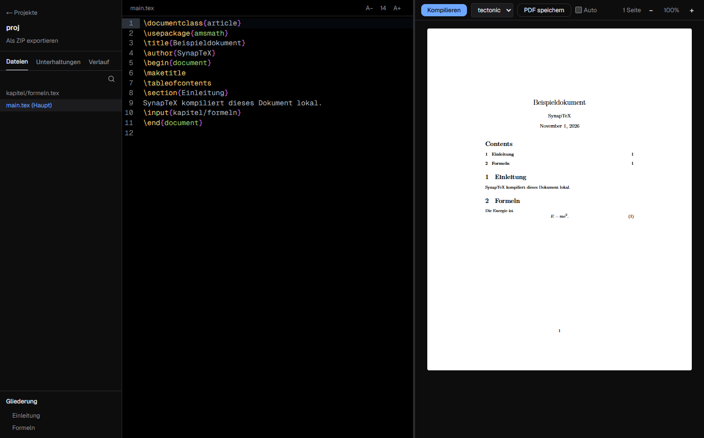

<div align="center">


# SynapTeX

[Deutsch](../../README.md) | [English](README.en.md) | [Türkçe](README.tr.md) | **Español** | [Français](README.fr.md)

**Un editor LaTeX local de escritorio con su propia IA en tu ordenador.**

Escribe y compila LaTeX sin la nube. Tus documentos y conversaciones con la IA se quedan en tu ordenador.

[](https://github.com/Teoman951/synaptex/releases/latest) [](https://github.com/Teoman951/synaptex/releases/latest)

<sub>Windows muestra una advertencia en el primer inicio porque el instalador aún no está firmado: elige "Más información" y luego "Ejecutar de todas formas".</sub>

</div>



## Por qué SynapTeX

- **Local:** La compilación y la IA se ejecutan en tu ordenador. No necesitas cuenta.
- **Continúa proyectos de Overleaf:** Importa el ZIP, compila y sigue escribiendo.
- **Errores útiles:** Un clic te lleva al lugar del error, y los errores frecuentes incluyen una pista. Por ahora las pistas están en alemán.
- **IA bajo tu control:** Las sugerencias entran en el documento solo después de revisar los cambios.

## Funciones

- Editor LaTeX con resaltado de sintaxis, guardado automático y puntos de control
- Carpetas de proyecto, esquema a través de `\input` e `\include`, vista general de proyectos
- Tectonic incluido, además de pdfLaTeX, XeLaTeX y LuaLaTeX con una instalación local de TeX
- Vista previa del PDF con zoom, selección de texto, guardado y clic para ir al código fuente
- Compilación automática opcional mientras escribes
- IA local (experimental): detecta modelos de Ollama, LM Studio, GPT4All y Hugging Face, o descarga uno con un clic

Los modelos locales pequeños cometen errores. Revisa las sugerencias antes de aplicarlas.

## Seguridad

Los documentos LaTeX pueden leer archivos fuera del proyecto al compilar y, con Tectonic, también escribir allí. SynapTeX avisa de comandos sospechosos, pero no detecta de forma fiable ataques dirigidos. Compila solo proyectos de fuentes de confianza.

## Estado

SynapTeX está en una fase temprana de desarrollo y se ha probado en Windows. La interfaz está disponible en cinco idiomas. Linux está disponible, pero sin probar. macOS aún no está disponible.

**Red:** Al iniciarse, la aplicación busca actualizaciones en GitHub y pregunta antes de descargar. Los paquetes y modelos solo se descargan cuando hacen falta.

## Desarrollo

Necesitas [Node.js](https://nodejs.org). Para proyectos de Overleaf se recomienda una distribución TeX como [MiKTeX](https://miktex.org).

```bash
git clone https://github.com/Teoman951/synaptex.git
cd synaptex
npm install
node scripts/fetch-tectonic.mjs
npm run dev:desktop
```

## Licencia

SynapTeX se publica bajo la [GNU Affero General Public License v3.0](../../LICENSE).
