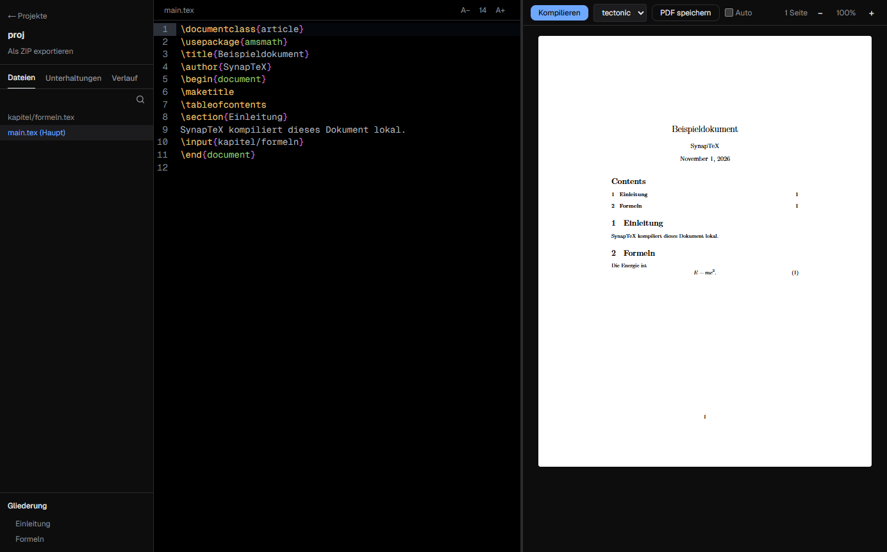

<div align="center">


# SynapTeX

[Deutsch](../../README.md) | [English](README.en.md) | [Türkçe](README.tr.md) | [Español](README.es.md) | **Français**

**Un éditeur LaTeX local pour ordinateur, avec sa propre IA sur votre machine.**

Écrivez et compilez du LaTeX sans cloud. Vos documents et vos conversations avec l'IA restent sur votre ordinateur.

[](https://github.com/Teoman951/synaptex/releases/latest) [](https://github.com/Teoman951/synaptex/releases/latest)

<sub>Windows affiche un avertissement au premier lancement, car l'installateur n'est pas encore signé : choisissez « Informations complémentaires », puis « Exécuter quand même ».</sub>

</div>



## Pourquoi SynapTeX

- **Local :** La compilation et l'IA s'exécutent sur votre ordinateur. Aucun compte n'est nécessaire.
- **Continuez vos projets Overleaf :** Importez le ZIP, compilez, continuez à écrire.
- **Erreurs utiles :** Un clic mène à l'emplacement de l'erreur, et les erreurs courantes sont accompagnées d'une indication. Les indications sont pour l'instant en allemand.
- **Une IA sous votre contrôle :** Les suggestions n'entrent dans le document qu'après vérification des modifications.

## Fonctionnalités

- Éditeur LaTeX avec coloration syntaxique, enregistrement automatique et points de contrôle
- Dossiers de projet, plan à travers `\input` et `\include`, vue d'ensemble des projets
- Tectonic inclus, ainsi que pdfLaTeX, XeLaTeX et LuaLaTeX via une installation TeX locale
- Aperçu PDF avec zoom, sélection de texte, enregistrement et clic vers le code source
- Compilation automatique facultative pendant la saisie
- IA locale (expérimentale) : détecte les modèles d'Ollama, LM Studio, GPT4All et Hugging Face, ou en télécharge un en un clic

Les petits modèles locaux font des erreurs. Vérifiez les suggestions avant de les appliquer.

## Sécurité

Les documents LaTeX peuvent lire des fichiers hors du projet à la compilation et, avec Tectonic, y écrire aussi. SynapTeX signale les commandes suspectes, mais ne détecte pas de façon fiable les attaques ciblées. Ne compilez que des projets de sources fiables.

## État du projet

SynapTeX est en début de développement et testé sous Windows. L'interface est disponible en cinq langues. Linux est proposé mais non testé. macOS n'est pas encore disponible.

**Réseau :** Au démarrage, l'application vérifie les mises à jour sur GitHub et demande avant de télécharger. Les paquets et les modèles ne sont téléchargés qu'en cas de besoin.

## Développement

Il vous faut [Node.js](https://nodejs.org). Pour les projets Overleaf, une distribution TeX comme [MiKTeX](https://miktex.org) est recommandée.

```bash
git clone https://github.com/Teoman951/synaptex.git
cd synaptex
npm install
node scripts/fetch-tectonic.mjs
npm run dev:desktop
```

## Licence

SynapTeX est publié sous la [GNU Affero General Public License v3.0](../../LICENSE).
