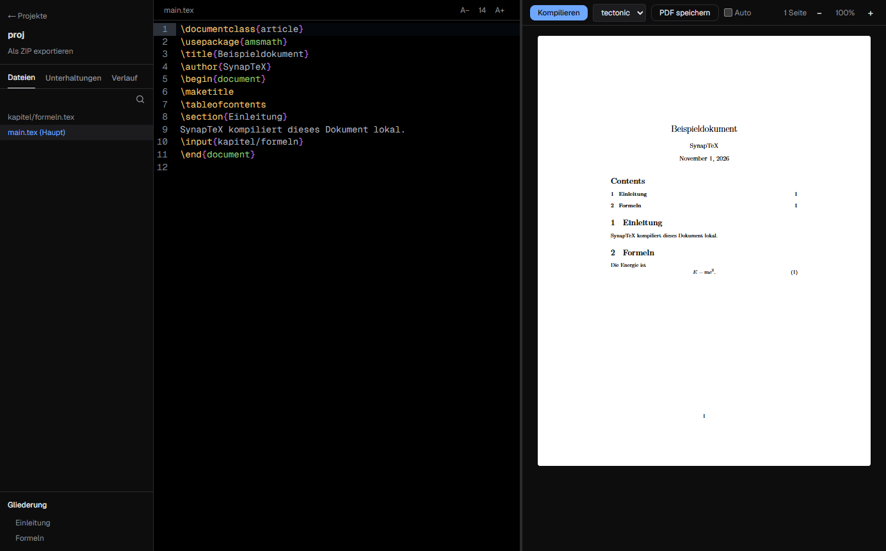

<div align="center">


# SynapTeX

[Deutsch](../../README.md) | [English](README.en.md) | **Türkçe** | [Español](README.es.md) | [Français](README.fr.md)

**Bilgisayarında kendi yapay zekâsıyla çalışan yerel LaTeX masaüstü editörü.**

LaTeX'i bulut olmadan yaz ve derle. Belgelerin ve yapay zekâ sohbetlerin bilgisayarında kalır.

[](https://github.com/Teoman951/synaptex/releases/latest) [](https://github.com/Teoman951/synaptex/releases/latest)

<sub>Yükleyici henüz imzalı olmadığı için Windows ilk başlatmada uyarı gösterir: "Ek bilgi", ardından "Yine de çalıştır" seçeneğini seç.</sub>

</div>



## Neden SynapTeX

- **Yerel:** Derleme ve yapay zekâ bilgisayarında çalışır. Hesap gerekmez.
- **Overleaf projelerine devam et:** ZIP dosyasını içe aktar, derle, yazmaya devam et.
- **Yardımcı hata mesajları:** Tek tıkla hatanın yerine gidersin, sık görülen hatalar için ipucu çıkar. İpuçları şimdilik Almancadır.
- **Kontrol sende:** Yapay zekâ önerileri, değişiklikleri inceledikten sonra belgeye eklenir.

## Özellikler

- Sözdizimi vurgulama, otomatik kaydetme ve kontrol noktaları içeren LaTeX editörü
- Proje klasörleri, `\input` ve `\include` üzerinden çalışan ana hat, proje genel görünümü
- Pakete dahil Tectonic; yerel TeX kurulumuyla pdfLaTeX, XeLaTeX ve LuaLaTeX
- Yakınlaştırma, metin seçme, kaydetme ve tıklayarak kaynağa gitme özellikli PDF önizlemesi
- Yazarken isteğe bağlı otomatik derleme
- Yerel yapay zekâ (deneysel): Ollama, LM Studio, GPT4All ve Hugging Face modellerini tanır veya tek tıkla model indirir

Küçük yerel modeller hata yapar. Önerileri uygulamadan önce kontrol et.

## Durum

SynapTeX erken geliştirme aşamasındadır ve Windows'ta test edilmiştir. Arayüz Almancadır. Linux sunulmaktadır ancak test edilmemiştir. macOS henüz mevcut değildir.

**Ağ:** Uygulama başlangıçta GitHub'da güncelleme olup olmadığını denetler ve indirmeden önce sorar. Paketler ve modeller yalnızca gerektiğinde indirilir.

## Geliştirme

[Node.js](https://nodejs.org) gerekir. Overleaf projeleri için [MiKTeX](https://miktex.org) gibi bir TeX dağıtımı önerilir.

```bash
git clone https://github.com/Teoman951/synaptex.git
cd synaptex
npm install
node scripts/fetch-tectonic.mjs
npm run dev:desktop
```

## Lisans

SynapTeX, [GNU Affero General Public License v3.0](../../LICENSE) ile lisanslanmıştır.
